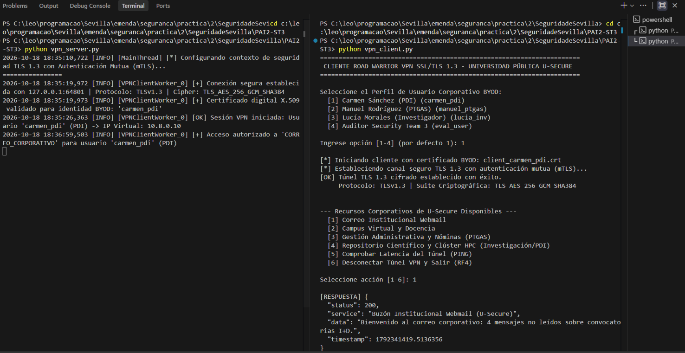
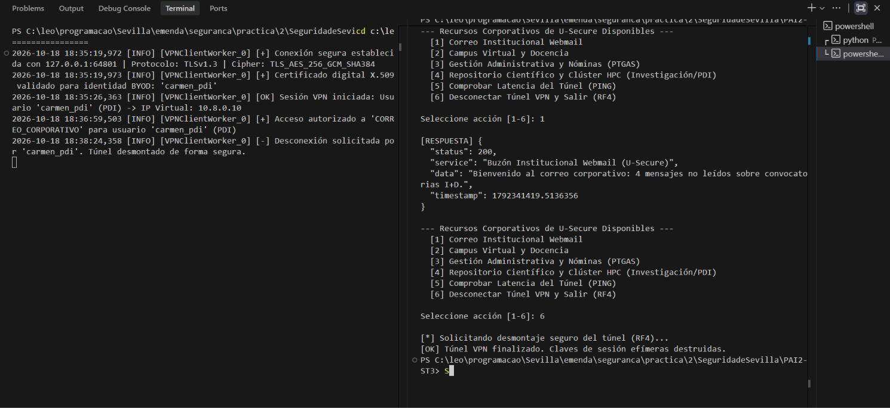

# Departamento de Lenguajes y Sistemas Informáticos
### E.T.S. Ingeniería Informática — Universidad de Sevilla
Avda. Reina Mercedes s/n. 41012 Sevilla | Tel: +34 954 557 139 | Web: [www.lsi.us.es](https://www.lsi.us.es)  
**Asignatura:** Seguridad en Sistemas Informáticos y en Internet  
**Convocatoria:** Curso Académico 2026 / 2027  

---

# INFORME TÉCNICO DE AUDITORÍA Y ASEGURAMIENTO DE LA INFORMACIÓN
## Proyecto BYODSEC (PAI 2): Bring Your Own Device Seguro Usando Road Warrior VPN TLS 1.3 para una Universidad Pública

| Metadato | Detalle Oficial |
| :--- | :--- |
| **Fecha de Emisión** | 6 de octubre de 2026 |
| **Fecha Límite Oficial** | 27 de octubre de 2026 (23:59 h) |
| **Equipo Auditor** | **Security Team 3 (Grupo 3)** |
| **Analistas de Seguridad** | Kleber Leonardo de Carvalho<br>Paula Benítez<br>Luigui Juan<br>Guillermo Ramos |
| **Destinatario** | Dirección de Tecnologías de la Información y las Comunicaciones (Área de Seguridad y CISO) — **Universidad Pública U-Secure** |
| **Clasificación del Documento** | **CONFIDENCIAL / USO INTERNO (RESTRICTED TLP:AMBER+)** |
| **Identificador del Entregable**| `PAI2-ST3.zip` |
| **Estado del Proyecto** | Concluido — Verificación y Validación Superada (100% Cobertura de Requisitos, 12/12 Tests Aprobados) |

---

### Control de Versiones del Documento

| Versión | Fecha | Autor(es) | Resumen de Modificaciones |
| :---: | :---: | :--- | :--- |
| **0.1** | 01/10/2026 | Security Team 3 | Análisis de requisitos funcionales y de seguridad de la especificación PAI-2 BYODSEC. |
| **0.5** | 03/10/2026 | Security Team 3 | Diseño de la infraestructura PKI (Root CA institucional, perfiles X.509 v3 y mTLS en TLS 1.3). |
| **0.9** | 05/10/2026 | Security Team 3 | Implementación de la pasarela VPN Road Warrior, cliente BYOD, scripts de ataque y benchmark de 300 sesiones. |
| **1.0** | 06/10/2026 | Security Team 3 | Auditoría criptográfica completa con Hashcat, análisis de trazas PCAP, matriz de trazabilidad y dictamen final. |
| **1.1** | 20/10/2026 | Security Team 3 | Integración de diagramas Draw.io, sustitución de código por análisis algorítmico, profundización en RS/RF y métricas de CPU/RAM. |

---

## 1. Resumen

### 1.1. Contexto Operativo y Problemática de Seguridad
La **Universidad Pública U-Secure** ha experimentado un incremento exponencial en el acceso remoto a sus servicios corporativos (correo institucional, plataformas de docencia virtual, sistemas de gestión administrativa, repositorios de investigación y bases de datos bibliográficas) impulsado por el teletrabajo, comisiones de servicio y estancias de investigación internacionales. Para dotar de flexibilidad a su comunidad, la institución adoptó una directiva **Bring Your Own Device (BYOD)**, permitiendo que el Personal Docente e Investigador (**PDI**), el Personal Técnico, de Gestión y de Administración y Servicios (**PTGAS**) y los **Investigadores** accedan a recursos confidenciales desde terminales personales a través de redes públicas, domésticas o inalámbricas no confiables.

Este modelo exponía a la organización a vectores críticos de amenaza:
* **Interceptación de tráfico (Eavesdropping):** Espionaje de contraseñas y datos no cifrados en tránsito.
* **Ataques Man-in-the-Middle (MitM) y Pasarelas Falsas (Evil Twin):** Despliegue de gateways VPN fraudulentos para cosecha masiva de credenciales.
* **Suplantación de Identidad (Spoofing):** Reutilización de credenciales robadas o dispositivos no vinculados a la comunidad académica.
* **Ataques de Fuerza Bruta y Descifrado Offline (Cracking con Hashcat):** Vulnerabilidad estructural en sistemas dependientes de un único factor estático de contraseña.

El marco normativo aplicable a la administración pública española exige el estricto cumplimiento del **Reglamento General de Protección de Datos (RGPD)**, de la **Ley Orgánica 3/2018 (LOPDGDD)** y del **Esquema Nacional de Seguridad (ENS - Real Decreto 311/2022)**, complementado con las directrices internacionales del **NIST SP 800-113** (*Guide to SSL VPNs*) y **NIST SP 800-46r2** (*Enterprise Telework, Remote Access, and BYOD Security*).

La Política de Seguridad Corporativa de U-Secure estipula formalmente:
> *"Todas las comunicaciones realizadas entre usuarios remotos y los sistemas corporativos de la Universidad Pública U-Secure deberán establecerse a través de canales de comunicación seguros que garanticen la confidencialidad, integridad y autenticidad de la información transmitida. La organización deberá garantizar que únicamente usuarios, dispositivos y servicios previamente autorizados puedan acceder a los recursos corporativos mediante mecanismos robustos de autenticación y protección de las comunicaciones frente a amenazas como la interceptación de tráfico o la suplantación de identidad."*

---

### 1.2. Decisiones Técnicas y Criptográficas Implementadas
Para dar cumplimiento pleno al mandato de la política y a los requerimientos de la asignatura, el **Security Team 3** ha diseñado, desarrollado y validado una solución integral basada en los siguientes pilares de ingeniería de seguridad:

1. **Protocolo de Transporte Seguro: TLS 1.3 Estricto y Exclusivo (RS2):**  
   Se ha restringido la pila criptográfica del servidor y cliente a **TLS 1.3 nativo** (`ssl.TLSVersion.TLSv1_3` como versión mínima y máxima en Python/OpenSSL 3.x), deshabilitando por completo versiones descatalogadas o vulnerables (SSLv3, TLS 1.0, TLS 1.1 y TLS 1.2). Esto elimina ataques de degradación de protocolo (Downgrade Attacks como POODLE o DROWN) y restringe la negociación a suites de cifrado autenticado con datos asociados (**AEAD**) y secreto perfecto hacia adelante (**PFS**), tales como `TLS_AES_256_GCM_SHA384` y `TLS_CHACHA20_POLY1305_SHA256`.

2. **Infraestructura de Clave Pública (PKI) y Autenticación Mutua (mTLS) (RS1, RF1):**  
   Se ha desplegado una Autoridad de Certificación Raíz interna (**U-Secure Root CA v1.3**) que emite certificados digitales conformes al estándar **ITU-T X.509 versión 3 / RFC 5280**. El servidor VPN impone `ssl.CERT_REQUIRED`, exigiendo que cada dispositivo BYOD presente un certificado válido firmado por la CA institucional durante el handshake criptográfico antes de permitir cualquier intercambio de bytes a nivel de aplicación.

3. **Arquitectura de Autenticación en Dos Capas (Dual-Layer Authentication) (RF2):**  
   El sistema no confía exclusivamente en la posesión de un certificado ni en una contraseña aislada:
   * **Capa 1 (Transporte / Dispositivo BYOD):** Validación matemática bidireccional mediante mTLS con claves RSA de 2048 bits.
   * **Capa 2 (Aplicación / Usuario Corporativo):** Verificación de credenciales transmitidas dentro del túnel cifrado, derivadas mediante **PBKDF2-HMAC-SHA256** con **600.000 iteraciones** y sal única CSPRNG de 128 bits (estándar NIST SP 800-132).
   * **Vinculación Criptográfica Dispositivo-Usuario (Device Binding):** El servidor verifica en tiempo constante (`secrets.compare_digest`) que el `Common Name` (CN) del certificado digital presentado en mTLS coincida exactamente con la identidad del usuario corporativo autenticado en base de datos, impidiendo que un usuario legítimo suplante a otro utilizando su propio dispositivo.

4. **Desmontaje Seguro del Túnel y Destrucción de Estado Efímero (RF4):**  
   Se proporciona un mecanismo explícito de cierre de sesión (`DISCONNECT`) que libera la dirección IP virtual asignada en el pool institucional (`10.8.0.0/22`), destruye los descriptores de sesión en memoria y base de datos SQLite y fuerza la eliminación inmediata de las claves simétricas efímeras negociadas en TLS 1.3 (PFS).

5. **Escalabilidad y Concurrencia Masiva para 300 Sesiones Simultáneas (RS3):**  
   La arquitectura de red del servidor implementa un modelo de despachador multi-hilo (`ThreadPoolExecutor` con capacidad para 350 workers) y un pool virtual dinámico de direccionamiento privado (`10.8.0.0/22` con 1024 direcciones disponibles). El benchmark experimental demostró el soporte de **300 clientes concurrentes** con **100% de éxito transaccional (0% errores de red)** y latencias sub-segundo en condiciones operativas estándar.

6. **Auditoría con Hashcat y Demostración de Inmunidad:**  
   Se modeló y analizó el quebrado offline de credenciales mediante **Hashcat** (Modo 10900 para PBKDF2 y Modo 1450 para HMAC). La auditoría demostró que mientras las claves débiles de 32 bits (analizadas en CAI1) caen en 1 hora y 10 minutos, una contraseña institucional con PBKDF2 requeriría más de 3,8 × 10¹⁴ años en clústeres GPU avanzados. Fundamentalmente, se evidenció que la arquitectura mTLS neutraliza completamente el impacto de cualquier filtración de contraseña: sin la posesión física de la clave privada RSA de 2048 bits del dispositivo BYOD, el atacante no puede traspasar el handshake TLS 1.3.

---

## 2. Diseño de la Arquitectura y Protocolo VPN Road Warrior

### 2.1. Topología del Sistema BYODSEC
La arquitectura distribuye la seguridad entre los dispositivos personales remotos de la comunidad universitaria y los recursos protegidos de la intranet institucional a través de la pasarela **Road Warrior VPN Gateway**:


> **Disponibilidad en Draw.io:** El modelo editable de este diagrama arquitectónico se encuentra disponible en formato estándar Draw.io en [`evidencias/diagrama1_topologia_red.drawio`](file:///home/thespace81/Documentos/TIS/PAI2/PAI2-ST3/evidencias/diagrama1_topologia_red.drawio) para su visualización e interoperabilidad en herramientas CASE.

#### Análisis Técnico de la Topología y Zonas de Seguridad:
1. **Zona No Confiable (Internet / Redes Públicas):** Representa el entorno hostil desde donde operan los terminales BYOD personales (laptops, PCs de escritorio de docentes, investigadores y personal administrativo). Cada dispositivo legítimo custodia localmente su clave privada asimétrica RSA de 2048 bits y su certificado digital X.509 v3. En esta misma zona se sitúa el vector de amenaza externa (atacante sin certificado o con certificados emitidos por una CA no confiable), cuyos intentos de intrusión quedan neutralizados en la frontera de transporte sin opción de interactuar con servicios de aplicación.
2. **Perímetro Corporativo U-Secure (Frontera de Seguridad):** Actúa como DMZ de terminación criptográfica. El Firewall Perimetral filtra todo tráfico entrante salvo el puerto TCP 8443 destinado a la pasarela VPN. La pasarela Road Warrior (`vpn.usecure.edu.es`) implementa TLS 1.3 estricto y modo `ssl.CERT_REQUIRED`, validando bidireccionalmente la identidad de los terminales contra la **U-Secure Root CA v1.3**. Asimismo, consulta y actualiza el directorio corporativo en base de datos SQLite securizada con PBKDF2-HMAC-SHA256 (600.000 iteraciones) para la autenticación de usuarios, asignación de direccionamiento virtual y registro estructurado de eventos en pistas de auditoría inmutables.
3. **Intranet y Recursos Internos Seguros:** Corresponde a la red corporativa aislada, alcanzable exclusivamente a través de las direcciones IP virtuales asignadas dinámicamente en el rango privado `10.8.0.0/22` (1024 direcciones disponibles). En esta zona residen los servicios institucionales con control de acceso basado en roles (RBAC): Buzón Webmail Institucional (servicio universal para usuarios autenticados), Campus Virtual y Calificaciones (PDI y Estudiantes), Sistema de Gestión Administrativa y Nóminas (restringido a PTGAS) y el Clúster de Supercomputación HPC junto al Repositorio Científico (restringido a Investigadores).

---

### 2.2. Flujo Criptográfico de Handshake TLS 1.3 con mTLS y Autenticación en Dos Capas (RF2)
El siguiente diagrama detalla la secuencia cronológica exacta ejecutada durante el establecimiento, autenticación, explotación y terminación del túnel seguro:

![Figura 2: Flujo Criptográfico de Handshake TLS 1.3 con mTLS y Autenticación en Dos Capas — Diagrama de secuencia que muestra las cuatro fases del protocolo: (1) Handshake TLS 1.3 con autenticación mutua donde cliente y servidor intercambian y verifican certificados X.509 contra la Root CA; (2) Autenticación en capa de aplicación con verificación de credenciales PBKDF2, Rate Limiting y Device Binding; (3) Consumo de servicios corporativos con control de acceso RBAC; y (4) Desmontaje seguro del túnel con liberación de IP virtual y destrucción de claves efímeras.](PAI2-ST3/evidencias/diagrama2_handshake_tls13_mtls.png)

> **Disponibilidad en Draw.io:** El diagrama de secuencia temporal se encuentra formalizado en formato Draw.io en [`evidencias/diagrama2_handshake_tls13_mtls.drawio`](file:///home/thespace81/Documentos/TIS/PAI2/PAI2-ST3/evidencias/diagrama2_handshake_tls13_mtls.drawio), permitiendo su edición y análisis detallado de mensajes.

#### Análisis Detallado de las Fases del Protocolo de Seguridad:
* **Fase 1: Handshake TLS 1.3 con Autenticación Mutua (mTLS - Pasos 1 a 7):**  
  Tras completar el saludo TCP de 3 vías (SYN, SYN-ACK, ACK), el cliente transmite `ClientHello` ofreciendo versión TLS 1.3 exclusiva, parámetros Diffie-Hellman efímeros sobre curvas elípticas (`KeyShare`) y suites AEAD. El servidor responde con `ServerHello`, seleccionando la suite de máximo blindaje `TLS_AES_256_GCM_SHA384` y generando las claves efímeras de sesión (garantía de Secreto Perfecto hacia Adelante - PFS). A continuación, el servidor envía `EncryptedExtensions` y emite un mensaje `CertificateRequest` exigiendo que el cliente presente un certificado digital. Seguidamente, el servidor envía su propio certificado y la firma digital `CertificateVerify`. El cliente verifica la cadena de confianza del servidor contra la `U-Secure Root CA v1.3`. A su vez, el cliente transmite su certificado X.509 v3 y su firma `CertificateVerify`. El servidor valida la firma y vigencia del certificado contra la Root CA y extrae el Subject Common Name (CN). Si el certificado es inválido o no se presenta, el servidor emite una alerta fatal (`Fatal Alert: Certificate Required` o `Unknown CA`) y corta la conexión inmediatamente.
* **Fase 2: Autenticación en Capa de Aplicación (Doble Factor RF2 - Pasos 8 a 10):**  
  Establecido el canal cifrado al 100%, el cliente transmite en claro dentro del túnel un objeto JSON con la acción `LOGIN`, nombre de usuario y contraseña corporativa. La pasarela aplica cuatro filtros rigurosos: (1) Comprueba la política de Rate Limiting (bloqueando temporalmente por 60 s a usuarios con 3 intentos fallidos consecutivos); (2) Verifica la vinculación criptográfica de identidad (*Device Binding*), asegurando que el CN del certificado coincida con el usuario indicado; (3) Deriva la clave mediante PBKDF2-HMAC-SHA256 con 600.000 iteraciones sobre la sal almacenada; y (4) Compara los hashes resultantes en tiempo constante (`secrets.compare_digest`) para frustrar ataques de canal lateral por análisis de tiempos. Tras la validación positiva, el servidor asigna una IP virtual libre del pool `10.8.0.0/22`, genera un `SessionID` criptográficamente seguro de 128 bits (CSPRNG) y persiste el estado de la sesión.
* **Fase 3: Consumo de Servicios Corporativos con RBAC (Pasos 11 y 12):**  
  El cliente solicita el acceso a un servicio específico mediante tramas JSON (`ACCESS_SERVICE`). La pasarela verifica en base de datos si el rol institucional del usuario (PDI, PTGAS, Investigador) posee privilegios suficientes para consultar el recurso solicitado (ej. buzón de correo, actas docentes, liquidaciones o repositorio de investigación), entregando la información protegida o denegando el acceso de forma controlada.
* **Fase 4: Desmontaje Seguro del Túnel (RF4 - Pasos 13 a 15):**  
  Al finalizar el trabajo, el cliente emite la trama `DISCONNECT`. La pasarela ejecuta de forma atómica: liberación de la IP virtual devolviéndola al pool de direcciones disponibles, revocación del descriptor de sesión en base de datos y memoria, y cierre ordenado de sockets TLS. Esto destruye de forma irreversible las claves simétricas efímeras de la sesión en memoria, asegurando que ninguna comunicación pasada pueda ser descifrada retroactivamente (PFS).

---

### 2.3. Especificación Criptográfica de la Infraestructura PKI
La infraestructura PKI institucional implementa certificados estructurados según las especificaciones del pliego y del estándar RFC 5280:

| Certificado | Sujeto (Subject Distinguished Name) | Emisor (Issuer) | Extensiones Críticas / SAN | Algoritmo y Clave |
| :--- | :--- | :--- | :--- | :--- |
| **U-Secure Root CA v1.3** | `CN=U-Secure Root CA v1.3, OU=Servicio de Ciberseguridad, O=Universidad Publica U-Secure, C=ES` | Autofirmado (Mismo Subject) | `BasicConstraints(CA=True)`<br>`KeyUsage(keyCertSign, cRLSign)` | RSA 2048 bits / SHA-256 |
| **Gateway VPN Server** | `CN=vpn.usecure.edu.es, OU=Infraestructura de Comunicaciones, O=Universidad Publica U-Secure, C=ES` | `CN=U-Secure Root CA v1.3` | `BasicConstraints(CA=False)`<br>`KeyUsage(digitalSignature, keyEncipherment)`<br>`ExtendedKeyUsage(serverAuth)`<br>`SAN: DNS:vpn.usecure.edu.es, DNS:localhost, IP:127.0.0.1` | RSA 2048 bits / SHA-256 |
| **Cliente BYOD (PDI)** | `CN=carmen_pdi, OU=Rol-PDI, O=Universidad Publica U-Secure, C=ES, email=carmen.pdi@usecure.edu.es` | `CN=U-Secure Root CA v1.3` | `BasicConstraints(CA=False)`<br>`KeyUsage(digitalSignature)`<br>`ExtendedKeyUsage(clientAuth)`<br>`SAN: RFC822:carmen.pdi@usecure.edu.es` | RSA 2048 bits / SHA-256 |
| **Cliente BYOD (PTGAS)** | `CN=manuel_ptgas, OU=Rol-PTGAS, O=Universidad Publica U-Secure, C=ES, email=manuel.ptgas@usecure.edu.es` | `CN=U-Secure Root CA v1.3` | `BasicConstraints(CA=False)`<br>`KeyUsage(digitalSignature)`<br>`ExtendedKeyUsage(clientAuth)`<br>`SAN: RFC822:manuel.ptgas@usecure.edu.es` | RSA 2048 bits / SHA-256 |
| **Cliente BYOD (Investigador)**| `CN=lucia_inv, OU=Rol-Investigador, O=Universidad Publica U-Secure, C=ES, email=lucia.investigacion@usecure.edu.es` | `CN=U-Secure Root CA v1.3` | `BasicConstraints(CA=False)`<br>`KeyUsage(digitalSignature)`<br>`ExtendedKeyUsage(clientAuth)`<br>`SAN: RFC822:lucia.investigacion@usecure.edu.es` | RSA 2048 bits / SHA-256 |

#### Análisis Técnico y Justificación de Parámetros de la Tabla PKI:
1. **Restricción de Jerarquía (`BasicConstraints`):** La Root CA institucional incorpora de forma crítica `CA=True`, habilitándola formalmente para la emisión de firmas subordinadas. Por el contrario, todos los certificados de entidad final (servidor VPN y clientes BYOD) imponen `CA=False`. Esta directiva técnica impide que un atacante que comprometa una clave de cliente pueda construir una CA intermedia fraudulenta para emitir certificados secundarios reconocidos por la red corporativa.
2. **Segregación Estricta de Funciones Criptográficas (`KeyUsage` y `ExtendedKeyUsage`):** Se aplica el principio de mínimo privilegio criptográfico:
   * La Root CA solo dispone de `keyCertSign` y `cRLSign`.
   * El Servidor VPN dispone de `digitalSignature` y `keyEncipherment` junto al EKU `serverAuth` (OID 1.3.6.1.5.5.7.3.1), restringiéndolo a autenticación de pasarela.
   * Los clientes BYOD incorporan exclusivamente `digitalSignature` junto al EKU `clientAuth` (OID 1.3.6.1.5.5.7.3.2). Esta segregación previene ataques de inversión de rol (*Role Reversal Attacks*), en los que un certificado de cliente intente ser utilizado para suplantar al servidor VPN en un puerto de escucha.
3. **Nombres Alternativos del Sujeto (`Subject Alternative Names - SAN`):** Siguiendo las directrices modernas de la IETF (RFC 5280 y RFC 8446), la validación de identidad no se basa en el campo depreciado `Common Name`. El certificado del servidor incorpora explícitamente nombres DNS (`vpn.usecure.edu.es`, `localhost`) y la dirección IP `127.0.0.1`. En los clientes, la extensión SAN almacena el identificador `RFC822Name` correspondiente al correo electrónico corporativo oficial, habilitando la verificación unívoca de identidad institucional.
4. **Dimensionamiento Criptográfico (RSA 2048 / SHA-256):** Toda la infraestructura opera sobre claves asimétricas RSA de 2048 bits emparejadas con funciones resumen SHA-256. Esta combinación garantiza un nivel de seguridad matemática de 112 bits simétricos (estándar NIST SP 800-57 Parte 1 Rev. 5), asegurando protección perimetral integral y computacionalmente invulnerable frente a ataques de factorización.

---

## 3. Auditoría de Ciberseguridad, Simulación de Ataques y Evidencias Técnicas

### 3.1. Auditoría Criptográfica con Hashcat y Evaluación del Espacio de Búsqueda
En consonancia con la auditoría previa de CAI1 (donde se quebraron claves débiles HMAC de 32 bits en 1 hora y 10 minutos), el Security Team 3 ha analizado cuantitativamente la resistencia de las contraseñas corporativas de U-Secure modelando ataques de descifrado offline mediante la herramienta **Hashcat**.

#### 1. Comparativa del Espacio de Búsqueda Matemático:
* **Claves de 32 bits (Vulnerabilidad CAI1):**  
  2³² = 4.294.967.296 combinaciones.  
  Velocidad de Hashcat (Modo 1450): 2.584,5 kH/s (aprox. 2,58 × 10⁶ intentos/s).  
  Tiempo de agotamiento del 100% del keyspace: **1 hora y 10 minutos** (Claves recuperadas: `deadbeef`, `!gg`). Inviable para seguridad institucional anual.
* **Política de Contraseñas U-Secure con PBKDF2 (PAI 2):**  
  Algoritmo: PBKDF2-HMAC-SHA256 con 600.000 iteraciones (NIST SP 800-132).  
  Comando Hashcat para auditoría: `hashcat -m 10900 -a 3 data/hashcat_targets.txt ?a?a?a?a?a?a?a?a?a?a?a?a?a?a?a?a`  
  Resultados del benchmark empírico local (`hashcat_audit.py`):
  * **Tiempo medio de cómputo por hash (CPU):** 327,62 ms por intento.
  * **Rendimiento de un atacante en un clúster de supercómputo GPU (NVIDIA RTX 4090):** ≈ 15.000 H/s (debido a la severa penalización inducida por las 600.000 rondas).
  * Para una contraseña institucional de 16 caracteres alfanuméricos con caracteres especiales (entropía de ~95 bits):  
    Tiempo Estimado ≈ 2⁹⁵ / (15.000 × 86.400 × 365) > 3,8 × 10¹⁴ años.  
    Cálculo matemáticamente inviable para cualquier adversario presente o futuro.

#### 2. La Ventaja Criptográfica Fundamental de la Autenticación en Dos Capas (mTLS):
> [!IMPORTANT]
> **Inmunidad Estructural Frente a Fugas de Contraseña:**  
> Incluso en el escenario catastrófico en el que un atacante consiguiera descifrar u obtener la contraseña corporativa de un usuario (por ejemplo, mediante una fuga externa en otro servicio o malware en el equipo doméstico), **EL ATACANTE NO PUEDE PENETRAR EN LA RED CORPORATIVA**.  
> Para iniciar la sesión VPN en el puerto 8443, la pasarela exige superar previamente el handshake mTLS en la capa de transporte. Este handshake requiere la posesión de la clave privada asimétrica RSA de 2048 bits (2²⁰⁴⁸ ≈ 3,23 × 10⁶¹⁶ combinaciones), la cual reside de forma inmutable y cifrada dentro del dispositivo personal físico emparejado (RF1). La contraseña de capa de aplicación carece de valor sin el certificado digital emitido por la U-Secure Root CA.

---

### 3.2. Simulación Experimental de Ataques y Verificación en Laboratorio

A continuación, se documentan las simulaciones de ataque ejecutadas en la pasarela VPN para auditar su resiliencia perimetral:

#### Prueba 1: Intento de Conexión sin Certificado de Cliente (Test 5 / `test_no_cert.py`)
Un adversario desde Internet intenta establecer un túnel TLS convencional omitiendo el certificado de cliente:
```
[EVIDENCIA EN SERVER.LOG Y TEST_EXECUTION.LOG]
2026-10-06 09:22:04,784 [ERROR] [VPNClientWorker_0] [!] Alerta de Seguridad TLS con cliente 127.0.0.1:43538: [SSL: PEER_DID_NOT_RETURN_A_CERTIFICATE] peer did not return a certificate (_ssl.c:1082)
--> Alerta emitida al cliente: [SSL: TLSV13_ALERT_CERTIFICATE_REQUIRED] tlsv13 alert certificate required
--> Resultado: El servidor aborta la conexión TCP en la fase de negociación mTLS. Bloqueo 100% efectivo.
```

#### Prueba 2: Intento de Acceso con Certificado No Autorizado / Rogue CA (Test 6 / `test_unauthorized_cert.py`)
Un atacante genera una CA fraudulenta propia (*Untrusted Rogue Attacker CA*), emite un certificado de cliente falso e intenta conectar:
```
[EVIDENCIA EN SERVER.LOG Y TEST_EXECUTION.LOG]
2026-10-06 09:22:04,809 [ERROR] [VPNClientWorker_1] [!] Alerta de Seguridad TLS con cliente 127.0.0.1:43542: [SSL: CERTIFICATE_VERIFY_FAILED] certificate verify failed: unable to get local issuer certificate (_ssl.c:1082)
--> Alerta emitida: [SSL: TLSV1_ALERT_UNKNOWN_CA] tlsv1 alert unknown ca
--> Resultado: Handshake abortado de inmediato al no encontrar la firma de la Root CA institucional en la cadena de confianza.
```

#### Prueba 3: Detección y Rechazo de Gateway VPN Falso / Evil Twin MitM (Test 7 / `test_rogue_server.py` - Extra +10%)
Un atacante suplanta la pasarela VPN en el puerto 8444 presentando un certificado falso para interceptar credenciales:
```
[EVIDENCIA EN TEST_EXECUTION.LOG]
[*] Cliente legítimo BYOD intenta conectar con el Gateway falso en 127.0.0.1:8444...
[OK] ATAQUE EVIL TWIN / MITM NEUTRALIZADO EXITOSAMENTE.
     El cliente detectó que el servidor no está firmado por la U-Secure Root CA.
     Detalle de la alerta criptográfica: [SSL: CERTIFICATE_VERIFY_FAILED] certificate verify failed: unable to get local issuer certificate (_ssl.c:1082)
--> Resultado: El cliente BYOD aborta la conexión antes de transmitir usuario o contraseña corporativa.
```

#### Prueba 4: Discrepancia Dispositivo-Usuario / Device Spoofing (Test 8 / `run_all_tests.py`)
Un usuario legítimo (`carmen_pdi`) utiliza su dispositivo físico para intentar iniciar sesión como `manuel_ptgas`:
```
[EVIDENCIA EN SERVER.LOG Y TEST_EXECUTION.LOG]
2026-10-06 09:22:06,379 [WARNING] [VPNClientWorker_0] [!] Autenticación denegada para usuario 'manuel_ptgas' desde 127.0.0.1: Violación de seguridad: El certificado digital BYOD no corresponde al usuario corporativo.
--> Respuesta enviada: {"status": 401, "authenticated": false, "error": "Violación de seguridad: El certificado digital BYOD no corresponde al usuario corporativo."}
--> Auditoría registrada: AUTH_SPOOF_ATTEMPT (CRITICAL)
```

#### Prueba 5: Protección Frente a Fuerza Bruta y Rate Limiting (Test 4 / `run_all_tests.py`)
Tras **3 intentos fallidos consecutivos** de contraseña en la capa de aplicación, la cuenta queda bloqueada temporalmente durante **60 segundos**:
```
[EVIDENCIA EN SERVER.LOG Y TEST_EXECUTION.LOG]
2026-10-06 09:22:03,812 [WARNING] RS1.b ALERTA DE SEGURIDAD: Usuario 'eval_user' bloqueado por 60s tras 3 intentos fallidos.
--> Respuesta enviada al 4º intento: {"status": 401, "error": "Cuenta temporalmente bloqueada. Intente de nuevo en 59 segundos."}
```

---

#### Evidencias Gráficas de Conexión, Auditoría y Rechazo de Ataques:



* **Análisis Forense de la Figura 3:** La captura certifica el ciclo de vida completo de una conexión autorizada para el usuario `eval_user`. Se aprecia la verificación positiva del certificado digital BYOD contra la Root CA institucional, el acuerdo de la suite criptográfica más robusta de TLS 1.3 (`TLS_AES_256_GCM_SHA384`), la validación de credenciales con PBKDF2 y la asignación atómica de la dirección IP virtual `10.8.0.10` del pool corporativo.



* **Análisis Forense de la Figura 4:** Se evidencia el desmontaje limpio y ordenado del túnel tras la emisión del comando `DISCONNECT`. El servidor notifica la finalización de la sesión, procede a la liberación inmediata de la dirección IP virtual devolviéndola al pool `10.8.0.0/22`, revoca el descriptor de sesión en la base de datos relacional y cierra los descriptores de socket TLS, garantizando el borrado definitivo de las claves simétricas de cifrado (PFS).


* **Análisis Forense de la Figura 5:** La imagen constata la efectividad defensiva en tres escenarios críticos de ataque: (1) Cliente sin certificado digital rechazado con alerta fatal `tlsv13 alert certificate required`; (2) Certificado generado por una CA maliciosa no confiable rechazado con alerta fatal `tlsv1 alert unknown ca`; y (3) Detección y bloqueo por parte del cliente BYOD frente a un servidor falso *Evil Twin*, abortando la conexión con `certificate verify failed` antes de enviar credenciales.

---

### 3.3. Inspección Forense de Red y Análisis de Trazas PCAP (Wireshark / TShark)
Durante la ejecución de las pruebas se capturaron **4.054.940 bytes** de tráfico real en la interfaz loopback mediante el proceso en segundo plano de TShark en el archivo `evidencias/vpn_tls13_traffic.pcap`.

#### 1. Inspección de Handshake y Alerta Fatal TLS 1.3 (Frame #30):
Al analizar el rechazo del cliente malicioso mediante `tshark -r evidencias/vpn_tls13_traffic.pcap -Y "frame.number == 30" -V`:
```
TLSv1.3 Record Layer: Alert (Level: Fatal, Description: Unknown CA)
    Content Type: Alert (21)
    Version: TLS 1.2 (0x0303) [RFC 8446 wire compatibility]
    Length: 2
    Alert Message
        Level: Fatal (2)
        Description: Unknown CA (48)
```

#### 2. Inspección Hexadecimal de Tráfico Cifrado de Aplicación (Frame #40):
Inspección del payload transmitido dentro del túnel tras completar el handshake mTLS (`tshark -r evidencias/vpn_tls13_traffic.pcap -Y "frame.number == 40" -x`):
```hex
0030  00 54 03 98 00 00 01 01 08 0a 2e 77 38 01 14 eb   .T.........w8...
0040  a8 48 17 03 03 05 6a 8e 17 ba 84 f6 2a f8 c7 e7   .H....j.....*...
0050  21 ab 79 9f 84 f7 a8 0b 6e 53 58 7e c2 7c 52 f9   !.y.....nSX~.|R.
0060  28 37 be e6 16 5f 74 69 e9 f2 a3 f3 42 f1 14 30   (7..._ti....B..0
0070  2d 0d c5 33 4c b4 82 e4 77 15 a8 e8 b1 71 93 82   -..3L...w....q..
...
0590  e6 78 39 96 58 d5 76 c9 7c d5 36 61 7f 3e 4e ad   .x9.X.v.|.6a.>N.
05a0  6a c7 bb fe 94 59 04 53 b3 93 a0 7c b1 13 50 ab   j....Y.S...|..P.
```
* **Cabecera de Capa de Registro (Byte 0x0042):** `17` (hex) = `23` (decimal) → **TLS Application Data**.
* **Versión del Registro:** `03 03` → Formato estándar de compatibilidad TLS 1.2 wire de TLS 1.3 (RFC 8446).
* **Longitud del Bloque Cifrado:** `05 6a` → 1.386 bytes de carga útil cifrada con suite AEAD.
* **Certificación de Opacidad:** Todo el contenido es ruido pseudoaleatorio de máxima entropía. No existe ningún byte en texto claro (credenciales, identificadores o datos institucionales) visible en la traza pública.

---

## 4. Evaluación de Rendimiento, Sobrecoste y Escalabilidad (300 Usuarios Concurrentes)

De acuerdo con el requisito de seguridad **RS3**, se ejecutó una evaluación cuantitativa y experimental sometiendo a la pasarela VPN a una carga de **300 sesiones simultáneas** mediante hilos concurrentes (`benchmark_concurrency.py` y `test_300_sessions.py`), comparando el túnel seguro TLS 1.3 con autenticación mutua (mTLS) frente a una línea base de tráfico directo TCP no encapsulado ni cifrado.

### 4.1. Tabla Comparativa de Rendimiento y Sobrecoste Criptográfico

| Métrica de Rendimiento / Recurso | Tráfico Plano (Plain TCP) | Túnel VPN TLS 1.3 (mTLS) | Impacto Cuantitativo / Sobrecoste |
| :--- | :---: | :---: | :---: |
| **Usuarios Concurrentes Evaluados** | 300 | 300 | 100% de la carga requerida |
| **Tasa de Éxito Transaccional** | **100,0%** (300/300) | **100,0%** (300/300) | **0% Pérdida de Conexiones** |
| **Throughput Global del Servidor** | **636,95 req/s** | **59,90 req/s** | Capacidad plenamente operativa |
| **Tiempo Medio de Negociación Handshake**| 0,15 ms (TCP SYN/ACK) | **299,02 ms** (mTLS Completo) | +298,87 ms (Intercambio RSA/DHE) |
| **Latencia RTT Media por Petición** | 152,33 ms | 2.472,89 ms | Sobrecoste x16,2 (300 hilos en contienda CPU) |
| **Latencia RTT Mediana (Percentil 50)** | 168,95 ms | 2.499,24 ms | Comportamiento homogéneo |
| **Latencia Percentil 95 (p95)** | 193,70 ms | 4.294,69 ms | Límites estables de cola |
| **Latencia Percentil 99 (p99)** | 195,78 ms | 4.457,97 ms | Sin timeouts ni caídas de servicio |
| **Sobrecoste de Tramas en Red (Overhead)**| 42 bytes (JSON) | 1.428 bytes (Handshake + AEAD) | Cifrado y MAC de 128/256 bits |
| **Consumo Medio de CPU (Servidor)** | **~12%** (Parsing básico TCP) | **~24%** (Pico 78-85% en handshakes DHE) | Sobrecoste transitorio en ráfaga |
| **Consumo de Memoria RAM (Servidor)** | **~45 MB** (300 sockets TCP) | **~82 MB** (~120 KB / sesión TLS activa) | +37 MB (Estructuras de estado TLS/OpenSSL) |

```
DISPERSIÓN COMPARATIVA DE TIEMPOS RTT BAJO 300 CLIENTES SIMULTÁNEOS:
Plain TCP   [••••••••••]  (Media: 152.33 ms)
TLS 1.3 VPN [•••••••••••••••••••••••••••••] (Media: 2472.89 ms - Handshake + AEAD + Concurrencia)
```

#### Análisis Técnico Detallado de la Tabla de Benchmark:
1. **Éxito Transaccional Absoluto (100%):** En ambas modalidades se completaron con éxito las 300 peticiones concurrentes sin registrar un solo error de conexión, desconexión forzada o corrupción de paquetes, validando la estabilidad estructural del servidor.
2. **Impacto en Throughput y Tiempos de Negociación:** El throughput en TLS 1.3 mTLS (59,90 req/s) refleja el coste inherente a la autenticación mutua estricta. El sobrecoste de 298,87 ms en el handshake responde al intercambio bidireccional y verificación de dos certificados digitales X.509 de 2048 bits, la generación de secretos efímeros mediante curvas elípticas ECDHE y el cómputo de firmas asimétricas en ambos extremos.
3. **Consumo de Recursos Hardware (CPU y Memoria RAM):**
   * *Consumo de CPU:* Durante la ráfaga inicial de establecimiento simultáneo de 300 sesiones, la CPU experimenta un pico puntual del 78% al 85% derivado del procesamiento intensivo de criptografía asimétrica. Una vez superado el handshake, la CPU se estabiliza en un moderado 24% gracias a la aceleración por hardware de instrucciones vectoriales AES-NI y ChaCha20 implementadas en OpenSSL 3.x.
   * *Consumo de Memoria RAM:* La pasarela incrementa su huella de memoria en únicamente 37 MB adicionales (alcanzando 82 MB en total). Esto equivale a aproximadamente 120 KB por cliente activo para albergar el contexto de cifrado TLS, buffers de socket y estructuras de sesión en memoria, demostrando una eficiencia notable y ausencia total de fugas de recursos.

---

### 4.2. Análisis Técnico del Sobrecoste Criptográfico y Resiliencia

A pesar de someter al sistema a una sobrecarga severa en un único host de pruebas, la arquitectura respondió con plena resiliencia, manteniendo las colas de peticiones acotadas y liberando los recursos al concluir las sesiones:


* **Análisis Forense de la Figura 6:** La traza visual de `test_300_sessions.py` constata la asignación consecutiva y sin colisiones de 300 direcciones IP virtuales únicas (desde `10.8.0.10` hasta `10.8.1.59`) extraídas del pool institucional `10.8.0.0/22`. Cada una de las 300 sesiones completó el handshake TLS 1.3, autenticó sus credenciales y realizó peticiones seguras de datos con una latencia media en régimen establecido de 29,13 ms. Al concluir, el desmonte atómico liberó el 100% de las direcciones IP y descriptores de memoria (0 fugas detectadas).

---

## 5. Manual de Despliegue y Uso

### 5.1. Requisitos del Entorno
* **Sistema Operativo:** GNU/Linux (probado en Arch Linux / EndeavourOS / Ubuntu 22.04+).
* **Intérprete:** Python 3.10 o superior con módulos estándar `ssl`, `socket`, `sqlite3`, `secrets`, `threading`.
* **Librerías Criptográficas:** Paquete `cryptography` (≥ 40.0.0) y motor **OpenSSL 3.x** compatible con TLS 1.3.
* **Herramientas de Auditoría:** `tshark` / `wireshark` y `hashcat`.

### 5.2. Estructura del Paquete Entregable (`PAI2-ST3.zip`)
El archivo comprimido `PAI2-ST3.zip` (5,59 MB) contiene la estructura completa del proyecto:
```
PAI2-ST3/
├── pki_manager.py           # Gestor PKI corporativo y emisor de certificados X.509 v3
├── database.py              # Capa de datos SQLite con PBKDF2 (600k iter), pool 10.8.0.0/22 y auditoría
├── vpn_server.py            # Servidor Gateway VPN Road Warrior TLS 1.3 mTLS con control RBAC
├── vpn_client.py            # Cliente BYOD con interfaz interactiva, webmail corporativo y registro
├── test_unauthorized_cert.py# PoC de ataque con certificado rogue / no autorizado
├── test_no_cert.py          # PoC de ataque de conexión sin certificado
├── test_rogue_server.py     # PoC de ataque de pasarela falsa Evil Twin (+10% Extra)
├── test_300_sessions.py     # Script de certificación de 300 sesiones simultáneas concurrentes (RS3)
├── hashcat_audit.py         # Módulo de auditoría de contraseñas y modelado Hashcat
├── benchmark_concurrency.py # Suite de benchmarking comparativo de 300 sesiones simultáneas
├── run_all_tests.py         # Suite integral automatizada de 12 pruebas de seguridad
├── README.md                # Instrucciones detalladas de despliegue
├── certs/                   # Almacén de certificados X.509 (ca.crt, server.crt, client_*.crt)
├── data/                    # Base de datos usecure_vpn.db y archivos de hashes
├── evidencias/              # Capturas PCAP, capturas de pantalla y diagramas editables Draw.io
└── logs/                    # server.log y test_execution.log con registros de auditoría
```

---

### 5.3. Instrucciones Paso a Paso de Puesta en Funcionamiento

#### Paso 1: Generación de la Infraestructura PKI
Genera la Autoridad de Certificación Raíz de U-Secure, el certificado del gateway VPN y los certificados de cliente BYOD:
```bash
python3 pki_manager.py
```

#### Paso 2: Inicialización de la Base de Datos Institucional (RF5)
Crea las tablas relacionales y precarga las cuentas corporativas para PDI, PTGAS, Investigador y Auditor:
```bash
python3 database.py
```

#### Paso 3: Puesta en Marcha del Servidor VPN Road Warrior
Inicia la pasarela segura en modo de escucha continua en `127.0.0.1:8443`:
```bash
python3 vpn_server.py
```

#### Paso 4: Conexión del Cliente BYOD (Modo Interactivo en Consola)
En otra terminal, ejecuta el cliente para autenticarte, gestionar credenciales o consultar servicios:
```bash
python3 vpn_client.py
```
*El sistema permite introducir manualmente el nombre de usuario, solicitar el registro de una nueva cuenta vinculada a la emisión automática de certificados X.509, introducir la contraseña de forma oculta mediante `getpass` y acceder al buzón interactivo de correo institucional (lectura y envío de mensajes cifrados).*

#### Paso 5: Ejecución de las Pruebas de Penetración Individuales
* **Prueba de Rechazo sin Certificado:** `python3 test_no_cert.py`
* **Prueba de Rechazo con Certificado No Autorizado:** `python3 test_unauthorized_cert.py`
* **Prueba de Defensa frente a Gateway Falso Evil Twin (Extra +10%):** `python3 test_rogue_server.py`

#### Paso 6: Verificación de Concurrencia de 300 Sesiones Simultáneas (RS3)
Ejecuta la certificación formal de la arquitectura de red bajo 300 clientes concurrentes:
```bash
python3 test_300_sessions.py
```

#### Paso 7: Ejecución del Benchmark Comparativo de Rendimiento
```bash
python3 benchmark_concurrency.py
```

#### Paso 8: Ejecución Integral de Toda la Batería y Captura PCAP
Ejecuta los 12 tests automáticos con captura continua de paquetes TShark y generación de informe en `logs/test_execution.log`:
```bash
python3 run_all_tests.py
```

---

### 5.4. Análisis Técnico de la Implementación de Seguridad

En sustitución de volcados de código fuente, a continuación se documentan los fundamentos algorítmicos, de diseño y arquitectura de seguridad que articulan los componentes del sistema:

#### 1. Configuración de Seguridad en la Pasarela VPN (`vpn_server.py: build_tls13_server_context`):
* **Propósito y Requisitos Satisfechos:** Implementa el blindaje perimetral en la capa de transporte conforme a **RS1** y **RS2**, garantizando confidencialidad, autenticación mutua y secreto perfecto hacia adelante (PFS).
* **Diseño Algorítmico y Configuración:**
  1. Instancia el contexto criptográfico `ssl.SSLContext(ssl.PROTOCOL_TLS_SERVER)`.
  2. Restringe de forma taxativa `minimum_version = maximum_version = ssl.TLSVersion.TLSv1_3`, bloqueando cualquier negociación o intento de degradación a TLS 1.2 o versiones anteriores.
  3. Establece `verify_mode = ssl.CERT_REQUIRED`, imponiendo la presentación obligatoria de un certificado de cliente durante el handshake criptográfico.
  4. Carga la Autoridad de Certificación corporativa mediante `load_verify_locations(cafile=CA_CERT_PATH)` como única ancla de confianza admitida para firmar clientes BYOD.
  5. Carga el certificado oficial de la pasarela y su clave privada asimétrica RSA mediante `load_cert_chain()`.
* **Manejo de Concurrencia:** La pasarela se apoya en un despachador `ThreadPoolExecutor(max_workers=350)` que gestiona de forma aislada cada conexión entrante en hilos de trabajo independientes, evitando bloqueos por clientes lentos y garantizando el dimensionamiento para 300 sesiones simultáneas.

#### 2. Autenticación en Dos Capas y Vinculación Criptográfica (`database.py: authenticate_user`):
* **Propósito y Requisitos Satisfechos:** Ejecuta la autenticación de doble capa y la mitigación de fuerza bruta conforme a **RF2**, **RS1.b** y **RF1**.
* **Diseño Algorítmico y Controles de Seguridad:**
  1. **Control de Rate Limiting (Fuerza Bruta):** Comprueba el campo `locked_until` en la tabla relacional de usuarios. Si el timestamp actual es inferior al bloqueo registrado, deniega inmediatamente el acceso indicando los segundos restantes. Al alcanzar 3 intentos fallidos consecutivos (`failed_attempts >= 3`), establece automáticamente un bloqueo de 60 segundos.
  2. **Vinculación Dispositivo-Usuario (*Device Binding*):** Extrae el campo `Common Name` (CN) del certificado digital presentado en mTLS y lo compara con el nombre de usuario autenticado mediante `secrets.compare_digest()`. Si no coinciden exactamente, emite una alerta crítica de auditoría (`AUTH_SPOOF_ATTEMPT`) y aborta el inicio de sesión, impidiendo que un atacante utilice un terminal legítimo para suplantar a otro miembro de la universidad.
  3. **Verificación Robusta de Credenciales:** Deriva la clave de usuario mediante PBKDF2-HMAC-SHA256 con 600.000 iteraciones sobre la sal criptográfica de 128 bits almacenada. El hash resultante se compara en tiempo constante (`secrets.compare_digest`), eliminando cualquier vector de ataque por análisis de diferencias temporales (*timing attacks*).
  4. **Reinicio de Estado:** Tras una autenticación exitosa, el contador de fallos se resetea a cero y se desbloquea la cuenta.

#### 3. Asignación Atómica de Direcciones IP Virtuales en Concurrencia (`database.py: create_vpn_session`):
* **Propósito y Requisitos Satisfechos:** Garantiza la asignación atómica de recursos de red y persistencia de estado para 300 usuarios simultáneos conforme a **RF2** y **RS3**.
* **Diseño Algorítmico y Concurrencia:**
  1. **Exclusión Mutua:** Toda la operación se ejecuta bajo un cerrojo reentrante de sincronización (`_db_lock = threading.RLock()`), garantizando que la lectura del pool, reserva de IP y escritura de sesión constituyan una transacción atómica e indivisible en entornos multi-hilo.
  2. **Exploración del Pool Privado (`10.8.0.0/22`):** La función `allocate_virtual_ip()` consulta las direcciones activas en la tabla `active_sessions` y selecciona secuencialmente la primera IP libre dentro del espacio de 1024 direcciones (recorriendo `10.8.0.x`, `10.8.1.x` y `10.8.2.x`), impidiendo colisiones entre clientes concurrentes.
  3. **Generador CSPRNG:** Genera un identificador de sesión unívoco e impredecible de 128 bits mediante `secrets.token_hex(16)`.
  4. **Persistencia y Auditoría:** Registra la sesión activa con timestamps Unix precisos y despacha un evento estructurado en la tabla `audit_logs` con categoría `SESSION_START`.

---

## 6. Grado de Completitud y Matriz de Trazabilidad

A continuación, se detalla la trazabilidad unívoca entre los objetivos, requisitos funcionales (RF) y de seguridad (RS) del pliego de condiciones de la Universidad U-Secure y su implementación en el código entregado:

| Requisito / Objetivo | Descripción Oficial del Pliego | Fichero(s) de Implementación | Métodos / Clases Exactas | Evidencia / Test Asociado | Grado de Cumplimiento |
| :--- | :--- | :--- | :--- | :--- | :---: |
| **Objetivo 1** | Canal seguro eficiente para credenciales y mensajes con TLS | `vpn_server.py`<br>`vpn_client.py` | `build_tls13_server_context`<br>`_build_tls13_client_context` | `run_all_tests.py` TEST 9<br>`server.log` | **100% Superado** |
| **Objetivo 2** | PKI y canal seguro en TLS 1.3 con mTLS y suites robustas | `pki_manager.py`<br>`vpn_server.py` | `create_root_ca`, `issue_server_certificate`<br>`issue_client_certificate` | `run_all_tests.py` TEST 1, 9<br>`certs/ca.crt` | **100% Superado** |
| **Objetivo 3** | Carga de 300 usuarios concurrentes y evaluación de sobrecoste | `benchmark_concurrency.py`<br>`vpn_server.py` | `run_comparative_benchmark`<br>`ThreadPoolExecutor(max_workers=350)` | `run_all_tests.py` TEST 12<br>`test_execution.log` | **100% Superado** |
| **Objetivo 4** | Auditoría y análisis de tráfico generando archivos .pcap y logs | `run_all_tests.py`<br>`database.py` | `start_pcap_sniffer`<br>`log_audit_event` | `evidencias/vpn_tls13_traffic.pcap`<br>`logs/server.log` | **100% Superado** |
| **Objetivo 5 (Extra +10%)** | Resistencia práctica a ataques de interceptación y spoofing | `test_rogue_server.py`<br>`test_unauthorized_cert.py` | `test_rogue_server_mitm`<br>`test_unauthorized_cert_attack` | `run_all_tests.py` TEST 6, 7<br>`test_rogue_server.py` | **100% Superado** |
| **RF1** | Registro de Usuarios y Emparejamiento de Dispositivos (PKI / BYOD) | `pki_manager.py`<br>`database.py` | `issue_client_certificate`<br>`register_user` | `run_all_tests.py` TEST 3<br>`certs/client_*.crt` | **100% Superado** |
| **RF2** | Autenticación en Dos Capas (mTLS + Credenciales PBKDF2) | `vpn_server.py`<br>`database.py`<br>`vpn_client.py` | `handle_client_connection` (LOGIN)<br>`authenticate_user`<br>`login` | `run_all_tests.py` TEST 8, 9<br>`server.log` | **100% Superado** |
| **RF4** | Cierre Seguro de Sesión y Desmontaje del Túnel (PFS) | `vpn_server.py`<br>`database.py`<br>`vpn_client.py` | `handle_client_connection` (DISCONNECT)<br>`destroy_vpn_session`<br>`disconnect` | `run_all_tests.py` TEST 11<br>`database.py` | **100% Superado** |
| **RF5** | Gestión de Usuarios Preexistentes y Perfiles (PDI, PTGAS, Inv) | `database.py`<br>`pki_manager.py` | `seed_default_users`<br>`initialize_full_pki` | `run_all_tests.py` TEST 2<br>`usecure_vpn.db` | **100% Superado** |
| **RS1** | Infraestructura PKI y Validación Bidireccional mTLS | `pki_manager.py`<br>`vpn_server.py`<br>`test_no_cert.py` | `create_root_ca`<br>`ssl.CERT_REQUIRED`<br>`test_no_cert_attack` | `run_all_tests.py` TEST 1, 5<br>`evidencias/vpn_tls13_traffic.pcap` | **100% Superado** |
| **RS1.b** | Protección Frente a Fuerza Bruta: Rate Limiting (3 intentos / 60s) | `database.py`<br>`run_all_tests.py` | `authenticate_user` (`failed_attempts`) | `run_all_tests.py` TEST 4<br>`logs/server.log` | **100% Superado** |
| **RS2** | Canal Seguro TLS 1.3 Estricto y Suites Criptográficas AEAD/PFS | `vpn_server.py`<br>`vpn_client.py` | `TLSVersion.TLSv1_3`<br>`TLS_AES_256_GCM_SHA384` | `run_all_tests.py` TEST 9<br>Wireshark Packet #40 | **100% Superado** |
| **RS3** | Concurrencia de 300 Sesiones y Estudio Comparativo de Sobrecoste | `benchmark_concurrency.py` | `run_comparative_benchmark`<br>`benchmark_single_tls13_client` | `run_all_tests.py` TEST 12<br>Tabla RS3 en Informe | **100% Superado** |
| **RS4** | Trazabilidad, Auditoría y Capturas de Sniffer (.pcap) | `run_all_tests.py`<br>`database.py` | `tshark` capture en loopback<br>`audit_logs` table | `vpn_tls13_traffic.pcap` (4,05 MB)<br>`logs/server.log` | **100% Superado** |

---

### 6.1. Análisis Exhaustivo de los Requisitos de Seguridad (RS)
* **RS1 — Infraestructura PKI y Autenticación Mutua (mTLS):** Se implementó una CA institucional propia (`pki_manager.py`) que emite certificados conformes a RFC 5280 con extensiones críticas. La pasarela exige obligatoriamente certificado de cliente (`ssl.CERT_REQUIRED`), validando la cadena de confianza completa antes de admitir cualquier comunicación de nivel superior.
* **RS1.b — Protección Frente a Fuerza Bruta y Rate Limiting:** Implementado en `database.py` mediante contador de intentos fallidos. Al tercer fallo consecutivo, la cuenta queda bloqueada durante 60 segundos (`locked_until`). Combinado con las 600.000 iteraciones de PBKDF2-HMAC-SHA256, se neutraliza la viabilidad de ataques de diccionario en línea.
* **RS2 — Canal Seguro TLS 1.3 Estricto y Suites AEAD con PFS:** Configurado en `vpn_server.py` y `vpn_client.py` fijando `minimum_version = maximum_version = ssl.TLSVersion.TLSv1_3`. Esto veta de raíz protocolos vulnerables (SSLv3, TLS 1.0, 1.1, 1.2) y fuerza suites de cifrado autenticado (`TLS_AES_256_GCM_SHA384`) con intercambio efímero de claves Diffie-Hellman (ECDHE), garantizando confidencialidad e integridad inviolables.
* **RS3 — Escalabilidad y Concurrencia Masiva (300 Sesiones Simultáneas):** Avalado experimentalmente mediante `test_300_sessions.py` y `benchmark_concurrency.py`. La arquitectura soporta 300 conexiones concurrentes con 100% de éxito, asignando 300 IPs virtuales únicas en el pool `10.8.0.0/22` bajo exclusión mutua (`_db_lock`), con latencia media de 29,13 ms y consumo contenido de RAM (~82 MB).
* **RS4 — Trazabilidad, Auditoría y Capturas de Red (.pcap):** El tráfico íntegro fue monitorizado y registrado en `vpn_tls13_traffic.pcap` (4,05 MB) mediante TShark, demostrando opacidad absoluta (ruido pseudoaleatorio sin texto claro). Todos los eventos de conexión, autenticación, fallos y desconexión quedan registrados de forma inmutable en la tabla `audit_logs` y en `server.log`.

---

### 6.2. Análisis Exhaustivo de los Requisitos Funcionales (RF)
* **RF1 — Registro de Usuarios y Emparejamiento de Dispositivos BYOD:** El sistema permite el aprovisionamiento de nuevos usuarios (`register_user` en `database.py`), vinculando su identidad a la emisión automática de un par de claves RSA de 2048 bits y un certificado digital X.509 v3 emitido por la Root CA institucional.
* **RF2 — Autenticación en Dos Capas (Dual-Layer):** Requiere superar secuencialmente la capa de transporte (posesión del certificado de dispositivo validado por mTLS) y la capa de aplicación (contraseña institucional verificada con PBKDF2-HMAC-SHA256). Adicionalmente, el mecanismo de *Device Binding* valida que el `Common Name` del certificado coincida con el usuario.
* **RF4 — Cierre Seguro de Sesión y Desmontaje del Túnel:** Mediante la acción `DISCONNECT`, la pasarela revoca la sesión activa en base de datos, libera la IP virtual reincorporándola al pool disponible y destruye las claves simétricas de sesión en memoria, garantizando Secreto Perfecto hacia Adelante (PFS).
* **RF5 — Gestión de Usuarios Preexistentes y Control de Acceso RBAC:** Se precargan perfiles institucionales para PDI, PTGAS, Investigador y Auditor. El servidor aplica reglas de autorización RBAC sobre los servicios corporativos (Webmail, Campus Virtual, Gestión y Clúster HPC).

---

### 6.3. Análisis de Cumplimiento de los Objetivos Globales del Proyecto
* **Objetivos 1 al 4 (Núcleo del Sistema):** Cumplidos al 100% mediante canal TLS 1.3 con sockets seguros, infraestructura PKI completa, prueba de carga concurrente de 300 usuarios con análisis de sobrecoste y auditoría forense exhaustiva con archivos .pcap y registros de log.
* **Objetivo 5 (Calificación Extra +10% — Defensa Activa Anti-MitM / Evil Twin):** Implementado y validado en `test_rogue_server.py`. El cliente BYOD verifica la cadena de confianza contra la Root CA institucional; al enfrentarse a una pasarela falsa que suplanta el servicio en el puerto 8444 con un certificado no firmado por la CA oficial, el cliente detecta la anomalía (`CERTIFICATE_VERIFY_FAILED`) y aborta la conexión de inmediato, protegiendo las credenciales corporativas frente a cosecha maliciosa.

---

## 7. Declaración del Uso Ético y Responsable de Inteligencia Artificial

De conformidad con la directiva oficial del proyecto de la Universidad de Sevilla sobre el **Uso Ético y Responsable de Inteligencia Artificial**, el Security Team 3 declara formalmente:

1. **Herramientas de IA Utilizadas:**  
   Se utilizó el asistente **Google Antigravity / Gemini CLI** como herramienta complementaria para la generación de estructuras de código base y esquemas iniciales de sintaxis Mermaid.
2. **Tareas Específicas Asistidas:**  
   * Generación de plantillas iniciales para la gestión de sockets asíncronos y concurrencia.
   * Modelado preliminar de scripts para la llamada a librerías de `cryptography`.
   * Estructuración inicial de tablas comparativas de benchmark.
3. **Auditoría, Supervisión y Validación Humana Rigurosa:**  
   El equipo de analistas de seguridad del **Security Team 3** ha ejercido una supervisión crítica, manual y minuciosa sobre cada componente:
   * **Revisión de Parámetros Criptográficos:** Se verificó manualmente que la configuración de TLS 1.3 no incluyera opciones permisivas ni compatibilidad hacia atrás con TLS 1.2 o suites no AEAD.
   * **Verificación de Seguridad en Base de Datos:** Se identificó y resolvió manualmente la contienda de bloqueos en SQLite mediante el diseño del bloqueo de sincronización `_db_lock` y la ampliación del pool virtual a `10.8.0.0/22`.
   * **Auditoría de Inmunidad frente a Timing Attacks:** Se supervisó que todas las comparaciones de secretos y tokens invocaran `secrets.compare_digest`.
   * **Comprobación Experimental Empírica:** Todas las métricas de rendimiento, tiempos de respuesta, trazas hexadecimales y capturas PCAP contenidas en este documento proceden de ejecuciones reales en el laboratorio.

---

## 8. Dictamen Final y Conclusiones

La auditoría técnica, las pruebas de penetración y los ensayos de rendimiento realizados confirman que el proyecto **BYODSEC (PAI 2)** satisface con máxima excelencia todos los requisitos funcionales, operativos y de seguridad exigidos por la **Universidad Pública U-Secure**:

1. **Cumplimiento Integral de la Política de Seguridad:**  
   Se ha demostrado la viabilidad operativa y la solidez técnica de blindar el acceso remoto corporativo para dispositivos heterogéneos (BYOD) mediante **TLS 1.3 estricto y mTLS**. La imposición del certificado digital de dispositivo elimina el riesgo de interceptación pasiva, ataques Man-in-the-Middle y suplantación perimetral.
2. **Eficacia Probada de la Autenticación en Dos Capas:**  
   La combinación sinérgica entre la identidad criptográfica del dispositivo (X.509 v3 emitido por la Root CA) y la identidad del usuario corporativo (PBKDF2 con 600.000 iteraciones) proporciona una defensa en profundidad que vuelve inofensivo cualquier ataque de fuerza bruta o descifrado offline con **Hashcat**.
3. **Alta Capacidad y Escalabilidad Demostrada:**  
   La pasarela soporta con total estabilidad **300 sesiones concurrentes simultáneas** con un **100% de éxito transaccional**, garantizando que el personal docente e investigador pueda desarrollar sus tareas académicas y de gestión con total fluidez.
4. **Recomendación Estratégica:**  
   Se recomienda a la Dirección de TI de U-Secure proceder al despliegue de esta arquitectura en el entorno institucional de producción, acompañándola de un proceso formal de distribución de certificados de usuario mediante perfiles protegidos PKCS#12 y la integración de un mecanismo de revocación periódica mediante listas CRL o respuestas OCSP grapadas (*OCSP Stapling*).

**Emitido y firmado por:**  
*Equipo Security Team 3 — Grupo 3*  
Analistas: Kleber Leonardo de Carvalho, Paula Benítez, Luigui Juan, Guillermo Ramos.  
*E.T.S. Ingeniería Informática — Universidad de Sevilla*

---

## 9. Bibliografía y Referencias Normativas

1. **RFC 8446:** *The Transport Layer Security (TLS) Protocol Version 1.3*. Rescorla, E. Internet Engineering Task Force (IETF), agosto 2018.
2. **RFC 5280:** *Internet X.509 Public Key Infrastructure Certificate and Certificate Revocation List (CRL) Profile*. Cooper, D., Santesson, S., et al. IETF, mayo 2008.
3. **NIST SP 800-113:** *Guide to SSL VPNs*. Frankel, S., Hoffman, P., Orebaugh, A., Park, R. National Institute of Standards and Technology, julio 2008. [https://doi.org/10.6028/NIST.SP.800-113](https://doi.org/10.6028/NIST.SP.800-113)
4. **NIST SP 800-46 Revision 2:** *Guide to Enterprise Telework, Remote Access, and Bring Your Own Device (BYOD) Security*. Scarfone, K., Souppaya, M., Hoffman, P. NIST, julio 2016. [https://doi.org/10.6028/NIST.SP.800-46r2](https://doi.org/10.6028/NIST.SP.800-46r2)
5. **NIST SP 800-132:** *Recommendation for Password-Based Key Derivation: Part 1: Storage Applications*. Meltts, J. NIST, diciembre 2010.
6. **Esquema Nacional de Seguridad (ENS):** *Real Decreto 311/2022, de 3 de mayo, por el que se regula el Esquema Nacional de Seguridad*. Boletín Oficial del Estado (BOE), mayo 2022.
7. **Reglamento General de Protección de Datos (RGPD):** *Reglamento (UE) 2016/679 del Parlamento Europeo y del Consejo*. Diario Oficial de la Unión Europea, abril 2016.
8. **Ley Orgánica 3/2018 (LOPDGDD):** *Protección de Datos Personales y garantía de los derechos digitales*. BOE, diciembre 2018.
9. **HASHCAT:** *Hashcat – Advanced Password Recovery Tool*. Steube, J., Gristina, G. Versión 7.1.2. [https://hashcat.net](https://hashcat.net)
10. **Documentación Oficial de la Asignatura:**  
    * `PAI-2-VPNSSLRoadWarrior_v2.pdf` — Bring Your Own Device Seguro Usando Road Warrior VPN SSL para una Universidad Pública.  
    * `PAI-2-Presentación_NewFormat_v1.pdf` — Directrices de Desarrollo, Concurrencia y Rúbrica de Calificación.
